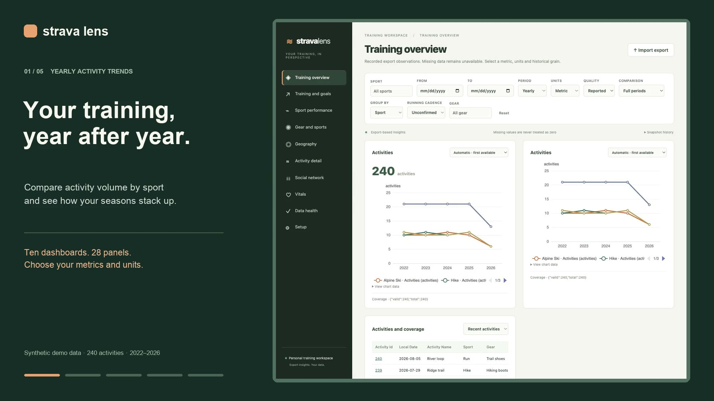
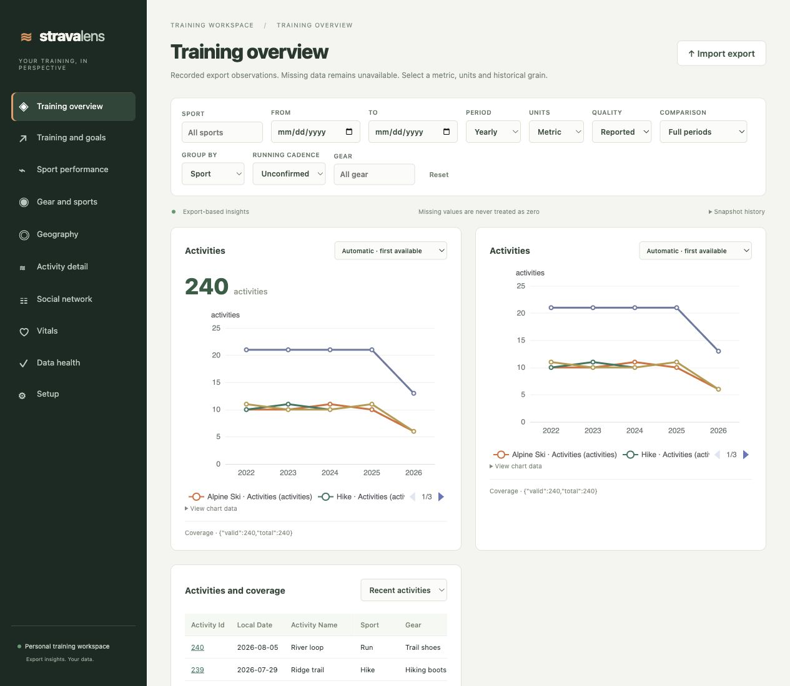
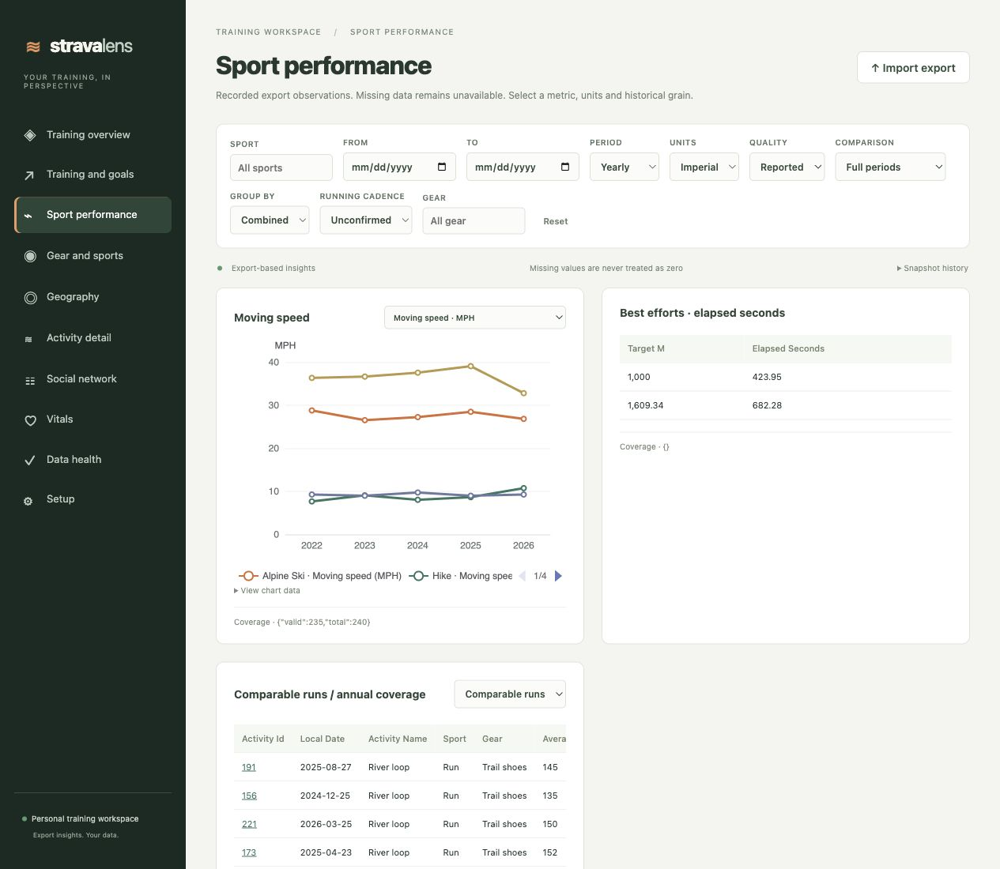
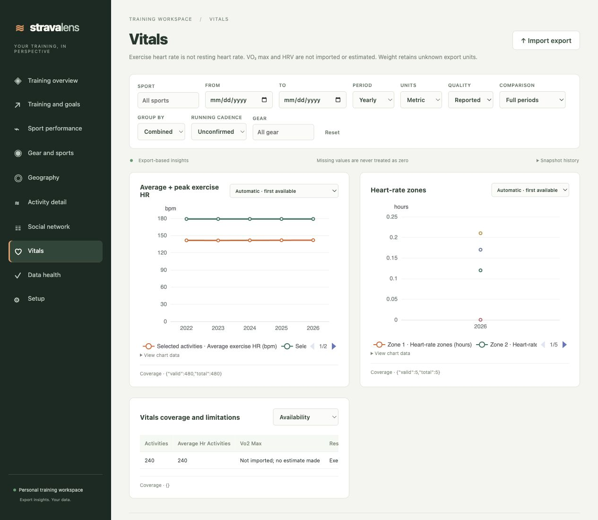
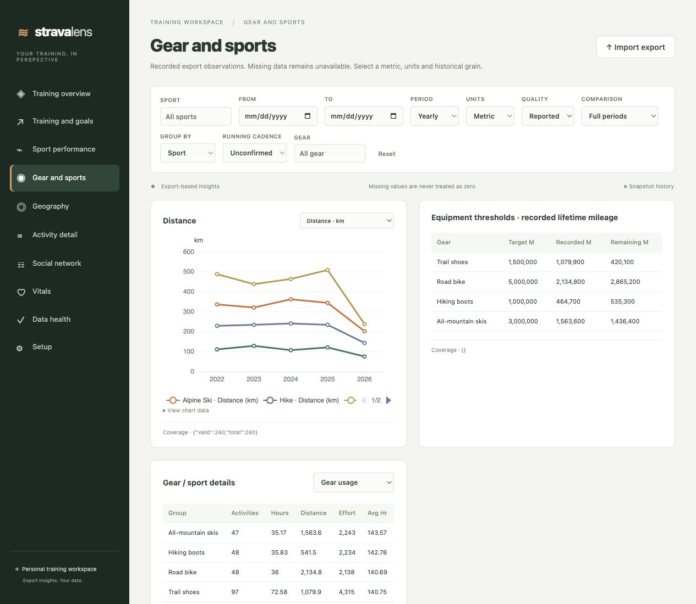
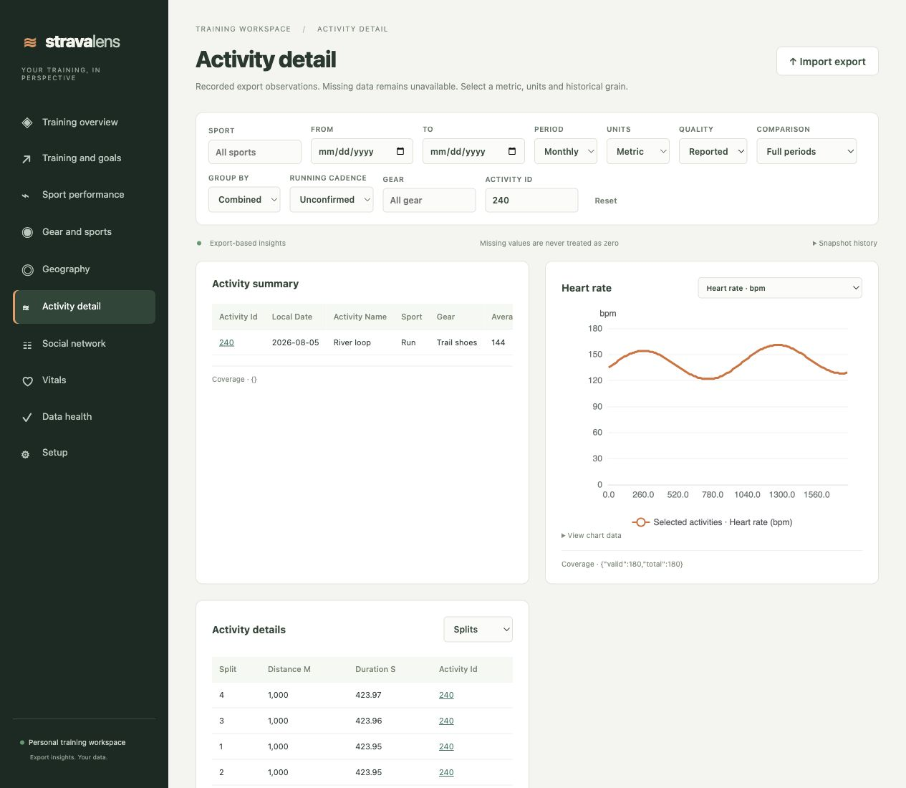

# Strava Lens

For those of us who finish a workout and immediately check the numbers, Strava Lens puts years of Strava history in one place. Compare mileage across seasons and pull up a run's heart-rate trace when you want a closer look.

The app runs on your own machine and reads Strava bulk exports. Its ten dashboards and 28 panels come from Training Lens for Splunk, with related metrics grouped into dropdowns. FastAPI and PostgreSQL handle durable imports and analytics; React and TypeScript run the reactive dashboard UI. You can also install the Python parser on its own.

The [installation and operations guide](docs/operations.md) covers getting it running. If you want to get under the hood, read the [architecture](docs/architecture.md), [dashboard parity mapping](docs/dashboard-parity.md) and [migration plan](docs/migration-plan.md).

## Watch the demo

A 30-second tour of Strava Lens, with voice narration.

[](docs/media/strava-lens-walkthrough-warm-voice.mp4)

[Watch or download the video](docs/media/strava-lens-walkthrough-warm-voice.mp4).

## Run the web app

Set up your inbox once: copy `.env.example` to `.env` and set the two independent secrets described there. Create the external Strava inbox and start the app:

```sh
mkdir -p "$HOME/StravaLens/inbox"
docker compose up
```

Open http://localhost:8080 and enter your configured token. Upload an export in Setup, or drop the original ZIP into `$HOME/StravaLens/inbox` on your computer. To keep your exports somewhere else, including an external disk, set `STRAVA_INBOX_DIR` in `.env` to that folder's absolute path. The worker mounts it read-only, so your original ZIPs stay on the host.

Imports run in a separate durable worker. When you add your next export, overlapping activities won't pad your totals: the app keeps versioned summaries, and each dashboard counts one selected ready snapshot. The [operations guide](docs/operations.md#drop-a-strava-export) explains how to copy large ZIPs safely, set permissions and follow import progress.

Use Overview and Training to look at the work you've put in over time, then dig into Sport Performance or Activity Detail. Gear and Sports, Geography, Social and Vitals cover the rest of your recorded history; Data Health and Setup handle imports and configuration. Every dashboard shares data-driven metric dropdowns, legends with the right units, historical filters and coverage indicators. Missing source measurements stay unavailable, including VO₂ max, HRV and historic follower dates.

## Screenshots

These app screens use synthetic demo data: 240 activities across five sports from 2022 to 2026.

Training overview: see how your activity count stacks up year to year, sport by sport.



Sport performance: compare speed across the years and check your recorded running best efforts.



Vitals: follow exercise heart rate over time and see how long you spent in your configured HR zones.



Gear and sports: keep an eye on the mileage and the replacement thresholds you set for your kit.



Activity detail: take a closer look at a workout's heart-rate trace and kilometre splits.



## Install the parser

To use the parser on its own, install it with Python 3.10 or newer:

```bash
python -m pip install .
```

## Parse an export

```python
from strava_lens_parser import inspect_export, iter_export

identity = inspect_export("export.zip", timezone="America/New_York")
print(identity.snapshot_id)

# Persist the first observation time in your job and reuse it on retries.
for record in iter_export(
    "export.zip",
    timezone="America/New_York",
    observed_at=1792252800,
):
    stage(record)  # Your persistence adapter; records remain provisional.
```

You supply the persistence function shown as `stage`; it is not part of the package. Consume the iterator to the end and verify the final `kind="snapshot"` manifest before activating an import. A fatal error can arrive after some records have already been yielded. The terminal manifest lists the expected groups, so you still need to check database readiness yourself.

Both functions accept `decode_streams`, `timezone`, `athlete_id`, and `config`. You can also pass `observed_at` (Unix seconds) to `iter_export`. Keep the staged ZIP unchanged throughout inspection and parsing. The parser writes no spool files, manifests, locks, logs or global state. Parsing the same data again produces the same logical IDs; your storage layer must enforce uniqueness and snapshot membership.

To validate an export locally and get a count report without saving or printing personal records:

```bash
python -m strava_lens_parser export.zip --timezone America/New_York
```

The CLI reads the whole iterator before reporting success and prints counts only. Use the Python API when you need to stage normalized records.

## Supported data

- Activities CSV, including duplicate headers. Measurements are normalized to SI, with source fields, quality flags, corrections and reporting dates retained. HR is supported; weight keeps its original export units.
- FIT/FIT.GZ via MIT-licensed fitdecode, plus the tested GPX/GPX.GZ adapter with supported HR, cadence and power extensions.
- Device laps, timer-aware HR zones, splits and continuous best efforts. Geographic cells are privacy-masked; exact GPS requires an explicit opt-in.
- Native follower/following observations and outgoing comments or kudos. Incoming interactions tied to individual athletes require the supplemental `social_interactions.csv` contract.
- Your configured goals and gear thresholds, along with structured exercise records.

If a stream format isn't supported, including TCX in this version, the parser quarantines it and keeps the valid CSV summaries available. Archive or schema failures reject the import. The parser doesn't estimate VO2 max, HRV or resting HR, or fill in unknown units and follow dates. It also rejects XML entities, unsafe ZIP paths, symlinks, encryption and excessive expansion.

The package version is `0.1.0`. The normalization/parser version stays at `1.0.3` so existing snapshot and revision identities keep their meaning. The on-disk parser format is unchanged.

## Development

```bash
python -m pip install -e '.[dev]'
python -m unittest discover -s tests -v
python -m build
```

Keep personal exports and parsed records out of commits. All examples and tests in the repo use synthetic data. [THIRD_PARTY_LICENSES](THIRD_PARTY_LICENSES) records where the code came from and how its dependencies are licensed.
